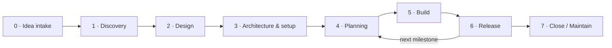

# Grimorio

Personal project workflow: guide, templates and Claude Code skills for running personal software projects end to end.

A single, opinionated workflow for running personal **software** projects end to end:
from a raw idea to a released, documented, maintainable app.

This repository is the **source of truth** for the workflow. It contains:

| Folder | What it holds |
|---|---|
| [`guide/`](guide/00-overview.md) | The workflow itself: phases, gates, deliverables, rituals, metrics, conventions |
| [`templates/notion/`](templates/notion/notion-setup.md) | Notion workspace setup (databases, views, charts) and page templates (task, bug, feature, milestone…) |
| [`templates/repo/`](templates/repo/) | Files copied into every new project repository (docs, ADRs, PR template, CI, quality tooling) |
| [`templates/quality/`](templates/quality/) | Code-quality presets per stack (Python, TypeScript, Flutter) |
| [`templates/workspace/`](templates/workspace/CLAUDE.md) | `CLAUDE.md` for the folder that holds all your projects (e.g. `~/proyectos/`) |
| [`claude/skills/`](claude/skills/) | Claude Code skills that apply the templates for you |
| [`examples/pantry/`](examples/pantry/) | A worked example (pantry manager) taken through phases 1–4 |

## The workflow in one picture



**Notion manages the work** (ideas, milestones, features, tasks, kanban, metrics).
**The repo holds the technical knowledge** (brief, design links, architecture, ADRs, specs, user manual, changelog).
A task ID such as `PAN-12` ties both worlds together: branch, commits and PR all carry it.

## Quick start: a new project

1. **Idea** → add a card to the Notion *Ideas* database ([guide](guide/01-idea-intake.md)). Wait one week.
2. **Create the repo** and bootstrap it:

   ```text
   /project-bootstrap
   ```

   (or copy `templates/repo/` by hand and replace every `{{PLACEHOLDER}}`).
3. **Write the brief** with `/project-brief` → `docs/project-brief.md`.
4. **Design in Penpot**, then fill `docs/design.md` ([guide](guide/03-design.md)).
5. **Architecture**: `docs/architecture.md` + ADRs (`/adr`), quality tooling, green CI ([guide](guide/04-architecture-and-setup.md)).
6. **Plan** milestones in Notion; break the first milestone into tasks with `/task-breakdown`.
7. **Build** on the kanban. **Release** each milestone with `/milestone-release`.

## First-time setup (once)

Build the Notion workspace following [`templates/notion/notion-setup.md`](templates/notion/notion-setup.md). Then set up each machine you work on.

## Setup on a new machine

Claude Code skills and settings live in `~/.claude/` and are **per machine** — nothing syncs between computers. Repeat these steps on every machine where you work on personal projects.

Recommended layout:

```text
~/grimorio/                 ← this repo (Grimorio)
~/proyectos/
  ├── CLAUDE.md             ← copied from templates/workspace/CLAUDE.md
  ├── despensa/             ← one folder per project, bootstrapped with /project-bootstrap
  └── gym-tracker/
```

1. **Clone this repo:**

   ```bash
   git clone https://github.com/qu3qui/grimorio.git ~/grimorio
   ```

2. **Install the Claude Code skills:**

   ```bash
   ~/grimorio/claude/install.sh
   ```

   This symlinks every folder in `claude/skills/` into `~/.claude/skills/`, so a `git pull` here updates the skills everywhere — no reinstall needed. The script works from any folder name.
3. **Create the projects folder and its `CLAUDE.md`:**

   ```bash
   mkdir -p ~/proyectos
   cp ~/grimorio/templates/workspace/CLAUDE.md ~/proyectos/CLAUDE.md
   ```

   Claude Code loads every `CLAUDE.md` from the current directory up to the root, so this file tells Claude — in every project under `~/proyectos/` — to follow this workflow. Edit the path inside it if you cloned the repo elsewhere.
4. **Let Claude read Grimorio from any project** without permission prompts. In `~/.claude/settings.json` (create it if missing; merge if it exists):

   ```json
   {
     "permissions": {
       "additionalDirectories": ["~/grimorio"]
     }
   }
   ```

5. **Install the base tooling** used by every project: `git`, `pre-commit` (`brew install pre-commit`) and the GitHub CLI (`brew install gh`, then `gh auth login`).
6. **Check it works:** open Claude Code in `~/proyectos/` and type `/` — `project-bootstrap`, `project-brief`, `feature-spec`, `task-breakdown`, `adr` and `milestone-release` should be listed.

### Manual-only skills

`/project-bootstrap` and `/milestone-release` make large or outward-facing changes (copying many files, tagging and publishing releases), so they are marked `disable-model-invocation: true`: Claude never runs them on its own — only when you type the command. The other skills can also be picked up automatically when your request matches their description.

## Improving the workflow

The workflow is itself a project. When a retro surfaces a lesson about *the process*,
open an issue or edit the relevant guide/template here and note it in [`CHANGELOG.md`](CHANGELOG.md).
