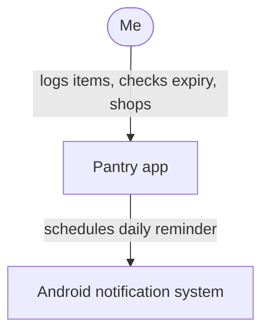
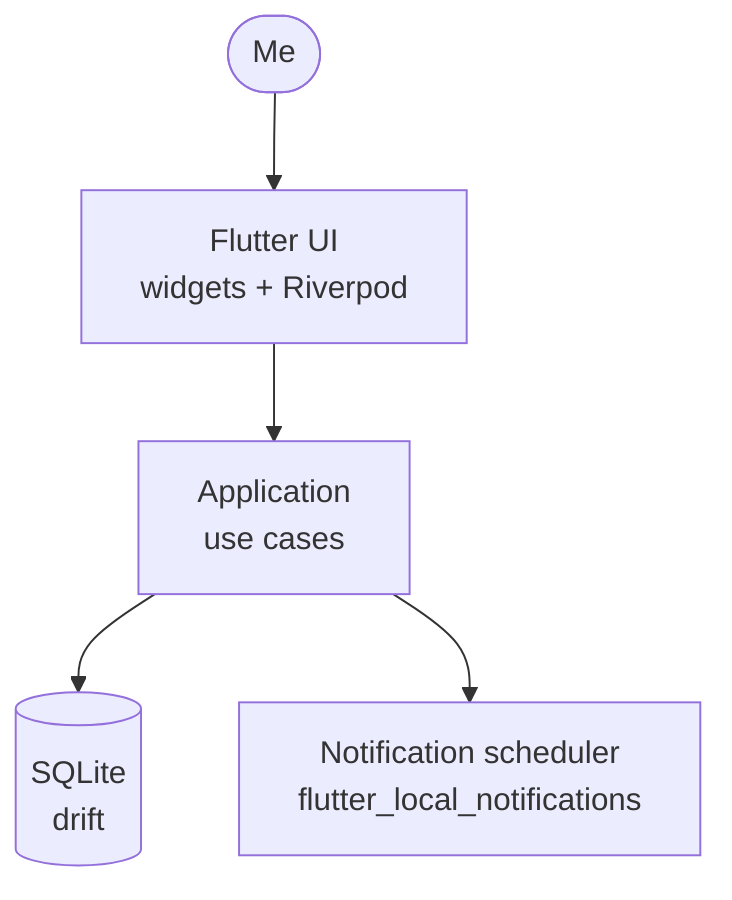
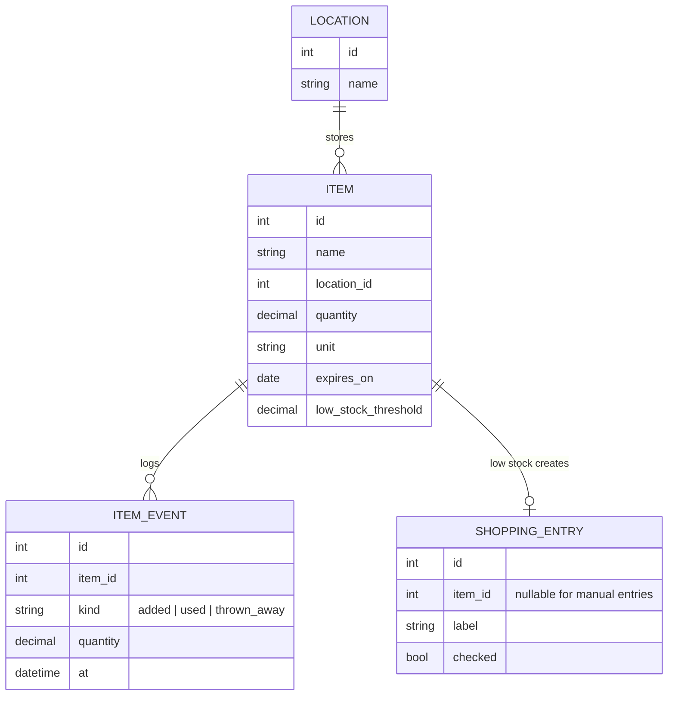
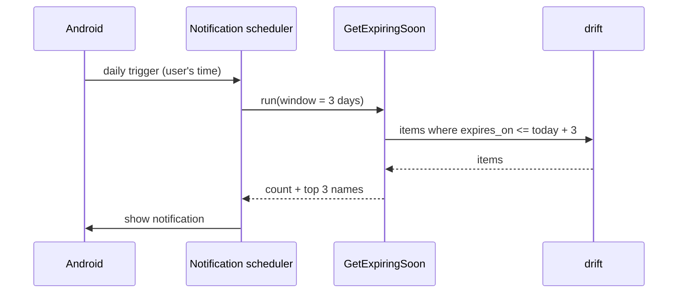

# Architecture — Pantry

> **Last updated:** 2026-10-26

## 1. Overview

Pantry is a single-user, offline-first Android app built with Flutter. All data lives in a local SQLite database accessed through drift. A daily local notification reminds the user of items expiring soon. There is no backend.

**Stack:** Flutter 3 + drift (SQLite) + Riverpod + flutter_local_notifications — see ADRs.

## 2. Non-functional requirements

| Concern | Requirement |
|---|---|
| Platforms | Android 10+ (iOS later, not tested) |
| Offline | 100% offline |
| Auth & privacy | No accounts; data never leaves the device |
| Performance | Cold start < 2 s; lists of 500 items scroll at 60 fps |
| Data volume | < 2 000 items, < 20 000 history rows |
| Availability / backups | JSON export/import (M3) |
| Cost | Zero |

## 3. System context (C4 level 1)



## 4. Containers (C4 level 2)



| Container | Technology | Responsibility | Deployed on |
|---|---|---|---|
| UI | Flutter, Riverpod | Screens, state | Phone |
| Application | Dart | Use cases (add item, mark used, build shopping list) | Phone |
| Database | SQLite via drift | Items, locations, history, settings | Phone |
| Notification scheduler | flutter_local_notifications | Daily expiry reminder | Phone |

## 5. Domain model



## 6. Code structure

```text
lib/
  domain/          # Item, Location, ItemEvent, expiry rules — pure Dart
  application/     # use cases + repository interfaces
  infrastructure/  # drift database, repositories, notification scheduler
  ui/              # screens, widgets, Riverpod providers
test/
```

**Dependency rule:** ui → application → domain; infrastructure implements application interfaces. `domain/` imports no Flutter packages.

## 7. Key flows



## 8. Cross-cutting concerns

- **Configuration & secrets:** none needed.
- **Error handling & logging:** use-case errors surface as snackbars; `debugPrint` only in debug builds.
- **Testing:** domain + application unit tests; drift in-memory DB for repository tests; 1 widget smoke test for the add-item flow. Coverage ≥ 70%.
- **Deployment:** release APK built locally; Play Store later (not planned).
- **Backups / data export:** JSON export/import in M3.

## 9. Decisions

| ADR | Title | Status |
|---|---|---|
| [0001](adr/0001-record-architecture-decisions.md) | Record architecture decisions | Accepted |
| [0002](adr/0002-use-flutter-with-drift-for-offline-storage.md) | Use Flutter with drift (SQLite) for offline storage | Accepted |
