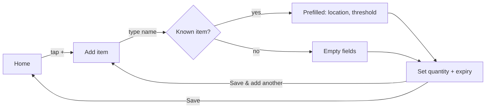
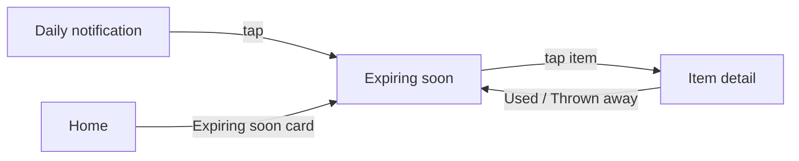
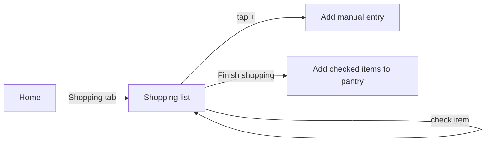

# Design — Pantry

> **Penpot project:** <https://design.penpot.app/#/workspace/…> (illustrative)

## Penpot pages

| Page | Link | Status |
|---|---|---|
| 00 Cover | … | ✅ |
| 01 User flows | … | ✅ |
| 02 Wireframes (low-fi) | … | ✅ |
| 03 Key screens (hi-fi) | … | ✅ Home, Add item |
| 04 Style guide | … | ✅ |

## User flows

### Scenario 1 — Unpacking groceries

### Scenario 2 — Planning meals

### Scenario 3 — Before shopping

## Screen inventory

| Screen | Purpose | Features (Must) | States designed | Wireframe | Hi-fi |
|---|---|---|---|---|---|
| Home | Overview: expiring soon, low stock, locations | Inventory, Expiry alerts | default · empty (first run) | ✅ | ✅ |
| Add / edit item | Capture fast, one hand | Inventory, Low-stock threshold | default · validation error | ✅ | ✅ |
| Item list (by location) | Browse and remove | Inventory | default · empty · search no results | ✅ | — |
| Item detail | Edit, remove (used / thrown away) | Inventory | default | ✅ | — |
| Expiring soon | Items expiring within N days | Expiry alerts | default · empty ("nothing expiring") | ✅ | — |
| Shopping list | Low stock + manual items | Shopping list | default · empty | ✅ | — |
| Settings | Expiring window, notification time | Expiry alerts | default · notifications denied | ✅ | — |

**Coverage check:** every Must feature appears in at least one row. ✅

## Style guide (summary)

| Token | Value |
|---|---|
| Primary | `#2E7D32` (green) |
| Accent | `#F9A825` (amber — "expiring") |
| Error | `#C62828` (red — "expired") |
| Neutrals | `#FAFAFA` → `#212121` |
| Font | Inter (12 / 14 / 16 / 20 / 28) |
| Spacing scale | 4 · 8 · 16 · 24 · 32 |
| Corner radius | 12 |

## Accessibility

- [x] Text contrast ≥ 4.5:1
- [x] Touch targets ≥ 48×48 dp
- [x] Expiry status uses icon + text, not only amber/red
- [x] Every input has a visible label

## Design decisions

| Date | Decision | Why |
|---|---|---|
| 2026-10-19 | "Save & add another" is the primary button on Add item | Scenario 1 is batch capture after shopping |
| 2026-10-19 | Removing an item asks *Used* or *Thrown away* | Needed for the waste success metric |
