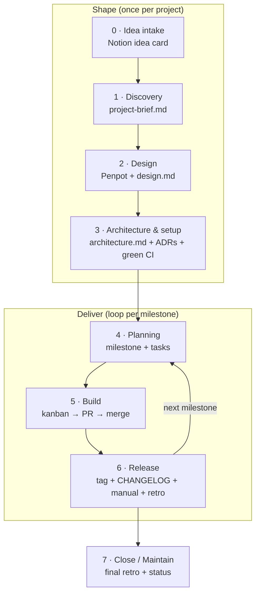

# 00 · Overview

## Why this workflow exists

The old habit was: *think of an app → start coding immediately → list features → tasks → kanban*.
It ships code, but it skips three things that make projects survive past the first burst of motivation:

1. **A defined scope** — what the MVP is, and just as important, what it is *not*.
2. **A design before code** — screens and flows decided in Penpot, not invented while coding.
3. **Documentation** — architecture, decisions and a user manual, so future-you can come back after months away.

On top of that, every project gets **code-quality tooling from day one**, so quality is automatic instead of a cleanup chore.

## Principles

1. **Gates, not bureaucracy.** Each phase ends with a short, checkable exit gate. If the gate passes, move on — don't polish.
2. **Small batches.** Tasks fit in one or two sessions (size ≤ M). Anything bigger is split.
3. **Stop starting, start finishing.** At most **2 tasks In Progress** (WIP limit).
4. **Plan one milestone ahead** (rolling wave). Only the next milestone is broken into tasks.
5. **Docs live next to the code they describe.** Management lives in Notion; technical knowledge lives in the repo.
6. **Automate quality.** Formatters, linters, type checks, tests and secret scanning run on every commit and in CI.
7. **Write decisions down.** Any choice you'd have to re-explain later becomes an ADR.
8. **Claude is a teammate.** Every phase has a skill or prompt that drafts the deliverable; you review and decide.

## Lifecycle

| # | Phase | Chapter | Main deliverables | Exit gate |
|---|---|---|---|---|
| 0 | Idea intake | [01](01-idea-intake.md) | Idea card with score | Decided to pursue after a 1-week cool-down |
| 1 | Discovery | [02](02-discovery.md) | `docs/project-brief.md` | MVP feature list closed, non-goals written |
| 2 | Design | [03](03-design.md) | Penpot file, `docs/design.md` | Every MVP feature has a flow + wireframe |
| 3 | Architecture & setup | [04](04-architecture-and-setup.md) | `docs/architecture.md`, ADRs, walking skeleton | CI green on `main`, key ADRs accepted |
| 4 | Planning | [05](05-planning.md) | Milestones, features, tasks in Notion | Next milestone's tasks are *Ready* |
| 5 | Build | [06](06-build.md) | Merged PRs, specs, ADRs | Each task meets Definition of Done |
| 6 | Release | [07](07-release.md) | Tag, CHANGELOG, release notes, user manual, retro | Milestone *Done*, retro filed |
| 7 | Close / Maintain | [08](08-close.md) | Final retro, project status | — |

Supporting chapters:
[09 Rituals](09-rituals.md) ·
[10 Metrics](10-metrics.md) ·
[11 Git & release](11-git-and-release.md) ·
[12 Code quality](12-code-quality.md) ·
[13 AI workflow](13-ai-workflow.md)

### Existing projects (e.g. one that already has an MVP)

Don't restart from phase 0. Retrofit in this order, one task each:

1. Write `docs/project-brief.md` describing what exists and what's next (non-goals included).
2. Add quality tooling + CI ([12](12-code-quality.md)); fix or baseline existing warnings.
3. Write `docs/architecture.md` from the current code and ADRs for the decisions already made (status *Accepted*, dated today, "retroactive").
4. Move the backlog into the Notion structure and continue from phase 4.

## Where things live

| Artifact | Notion | Repo |
|---|---|---|
| Ideas, projects portfolio | ✅ | |
| Milestones, features, tasks, bugs | ✅ | |
| Kanban, timeline, metrics | ✅ | |
| Weekly reviews, retros | ✅ | |
| Project brief | link | ✅ `docs/project-brief.md` |
| Design (flows, wireframes) | link | Penpot + ✅ `docs/design.md` |
| Architecture, data model | link | ✅ `docs/architecture.md` |
| Decisions | link | ✅ `docs/adr/` |
| Feature specs | link | ✅ `docs/specs/` |
| User manual | link | ✅ `docs/user-manual.md` |
| Changelog, release notes | link | ✅ `CHANGELOG.md` + GitHub Releases |
| AI context | | ✅ `CLAUDE.md` |

**Rule of thumb:** if it changes when the code changes, it goes in the repo. If it tracks *doing* the work, it goes in Notion.

## Glossary

| Term | Meaning |
|---|---|
| **Project** | One app/product. Has a 3-letter prefix (e.g. `PAN`). |
| **Milestone** | A shippable increment with a version (e.g. *M1 · MVP core → v0.1.0*). Has dates and dependencies. |
| **Feature** | A user-visible capability (e.g. *Expiry alerts*). Belongs to one milestone. |
| **Task** | One unit of work, size XS–M. Types: Feature task, Bug, Chore, Spike, Docs. |
| **Spike** | Time-boxed research to reduce uncertainty. Output is a note or ADR, not production code. |
| **ADR** | Architecture Decision Record — a short doc capturing one decision, its context and consequences. |
| **DoR / DoD** | Definition of Ready / Definition of Done — checklists for entering *Ready* and *Done*. |
| **Walking skeleton** | The thinnest end-to-end version of the app, deployed/runnable, with CI — built before features. |
| **WIP** | Work in progress. Limits: *In Progress* ≤ 2, *Review/Test* ≤ 2. |
