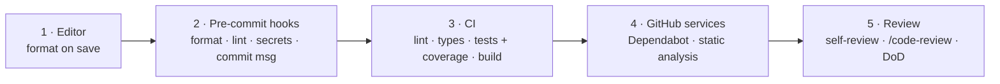

# 12 · Code quality

Quality is enforced by **tools at five layers**, from the cheapest feedback (your editor, milliseconds) to the most expensive (review). Every project gets layers 1–3 during the walking skeleton ([phase 3](04-architecture-and-setup.md)); layer 4 is switched on in GitHub; layer 5 is part of every PR.



## Layer 1 — Editor

- `.editorconfig` (in [`templates/repo/`](../templates/repo/.editorconfig)) — indentation, line endings, final newline.
- Enable *format on save* with the stack's formatter (Ruff, Biome, `dart format`).
- Install the linter's editor extension so problems show while typing.

## Layer 2 — Pre-commit hooks

Framework: [`pre-commit`](https://pre-commit.com) (`brew install pre-commit`). Language-agnostic, versioned config in the repo.

Shared hooks ([`templates/repo/.pre-commit-config.yaml`](../templates/repo/.pre-commit-config.yaml)):

| Hook | Purpose |
|---|---|
| `trailing-whitespace`, `end-of-file-fixer`, `mixed-line-ending` | Hygiene |
| `check-yaml`, `check-json`, `check-toml`, `check-merge-conflict` | Catch broken files |
| `check-added-large-files` | Keep binaries out of git |
| `detect-private-key`, **`gitleaks`** | Never commit secrets |
| **`conventional-pre-commit`** (`commit-msg` stage) | Enforce Conventional Commits |

Plus the stack hooks from `templates/quality/<stack>/pre-commit-hooks.yaml` (formatter + linter + fast type check).

Setup in each repo:

```bash
pre-commit install --hook-type pre-commit --hook-type commit-msg
pre-commit autoupdate        # pin the latest hook versions
pre-commit run --all-files   # must pass before the first PR
```

## Layer 3 — CI (GitHub Actions)

The workflow in `templates/quality/<stack>/ci.yml` runs on every push to `main` and every PR:

1. **pre-commit job** — the same shared hooks as local (nobody can skip them with `--no-verify`). Stack hooks that need the SDK are skipped here (`SKIP=…`) because the quality job runs them.
2. **secrets job** — `gitleaks` over the full git history.
3. **quality job:**
   - **Lint & format check** — fails on any warning.
   - **Type check** — strict mode.
   - **Tests + coverage threshold** — fails under the threshold.
   - **Build** — the app compiles/bundles.

**Branch protection on `main`:** require the CI checks to pass, require a PR (no direct pushes), require linear history (squash).

### Testing strategy

| Level | What | Share | Speed |
|---|---|---|---|
| Unit | Domain logic, pure functions, view models | ~70% of tests | ms |
| Integration | DB repositories, API handlers, services with real adapters | ~25% | s |
| End-to-end / smoke | Main scenario through the UI | 1–3 tests | slow |

- **Coverage threshold: 70% overall**, aim higher on domain code. Coverage is a floor, not a goal — don't write tests just to hit it.
- Every bug fix includes a regression test.
- Tests are deterministic: no real network, no wall-clock time without injection.

## Layer 4 — GitHub services

| Service | What | Cost / availability |
|---|---|---|
| **Dependabot version updates** | Weekly PRs bumping dependencies and GitHub Actions ([`dependabot.yml`](../templates/repo/.github/dependabot.yml)) | Free, all repos |
| **Dependabot alerts / security updates** | Vulnerable dependency alerts + auto PRs | Free, enable in *Settings → Code security* |
| **Secret scanning / push protection** | Blocks pushes containing known token formats | Free on public repos; on private repos depends on your GitHub plan — `gitleaks` covers you either way |
| **CodeQL code scanning** | Semantic static analysis for security bugs | Free on public repos (*Settings → Code security → Default setup*) |
| **Semgrep CE** | Static analysis rules for many languages, runs in CI | Free/open source; use for private repos where CodeQL isn't available |
| **SonarQube Cloud** | Quality dashboard: bugs, smells, duplication, coverage trend | Free for public projects; check current limits for private |

Recommended default: **Dependabot + CodeQL** for public repos; **Dependabot + Semgrep job** (snippet below) for private repos. Add SonarQube Cloud only if you want the trend dashboard.

```yaml
  semgrep:
    runs-on: ubuntu-latest
    container: semgrep/semgrep
    steps:
      - uses: actions/checkout@v4
      - run: semgrep scan --config auto --error
```

## Layer 5 — Review

Solo projects still get reviewed:

1. **Self-review the diff on GitHub** after a break — reading it in a different tool than your editor surfaces mistakes.
2. **`/code-review`** in Claude Code on the branch; fix or consciously dismiss each finding.
3. **PR template checklist** = the Definition of Done.

## Stack presets

| Stack | Formatter + linter | Types | Tests + coverage | Preset |
|---|---|---|---|---|
| Python | Ruff (`ruff format`, `ruff check`) | mypy (strict) | pytest + pytest-cov (`--cov-fail-under=70`) | [`templates/quality/python/`](../templates/quality/python/) |
| TypeScript (web/Node) | Biome (`biome ci`) | `tsc --noEmit` (strict) | Vitest + v8 coverage thresholds | [`templates/quality/typescript/`](../templates/quality/typescript/) |
| Flutter / Dart | `dart format`, `flutter analyze` + very_good_analysis | Dart analyzer (strict modes) | `flutter test --coverage` + min coverage check | [`templates/quality/flutter/`](../templates/quality/flutter/) |

**Another stack?** Pick one tool per column (formatter, linter, type checker, test runner with coverage), add a folder under `templates/quality/` with the same four files (`README.md`, config(s), `pre-commit-hooks.yaml`, `ci.yml`) and record the choice in an ADR.

## Rules of thumb

- **Zero warnings policy:** linters run with warnings as errors in CI. If a rule is wrong for the project, disable it in config with a comment why — never inline-ignore without a reason.
- **Complexity:** keep functions small; Ruff `C901` (max complexity 10) and Biome `noExcessiveCognitiveComplexity` flag offenders.
- **Existing project with many warnings?** Baseline: fix formatting in one commit, then enable rules incrementally, one Chore task per rule group.
