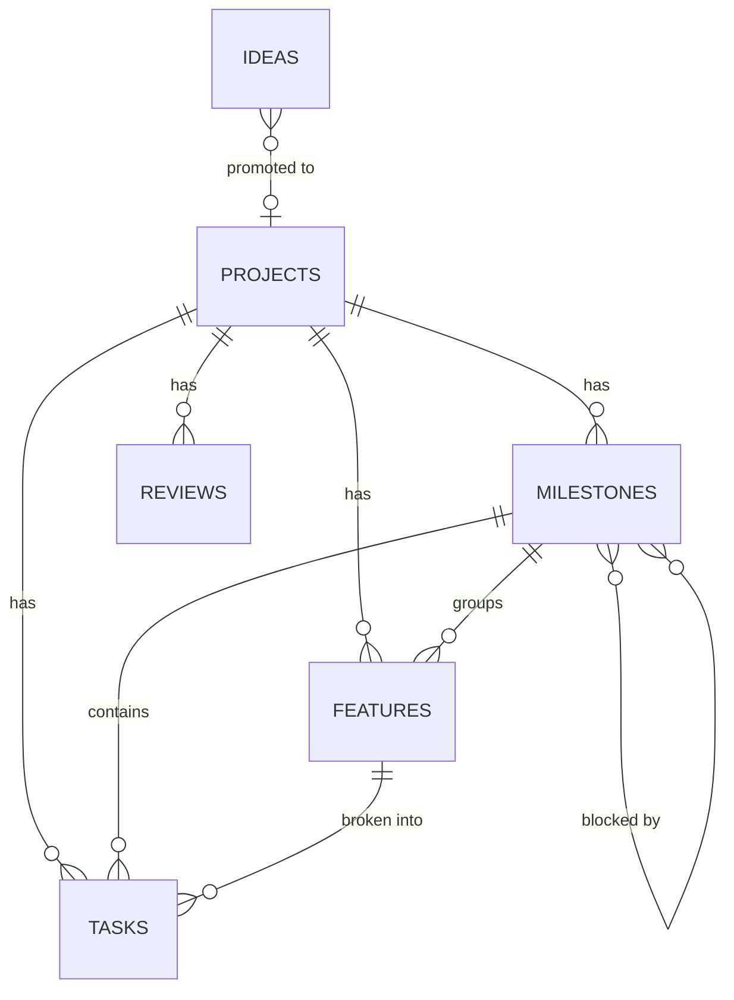

# Notion workspace setup

One-time setup (~1.5 h). Result: a **Project Management** teamspace/page with six related databases shared by all projects, so the kanban, throughput and portfolio work across projects and can be filtered per project.

> Tasks relate to **both** Feature and Milestone. It's a small duplication that makes milestone progress a single rollup. `/task-breakdown` fills both; the weekly review catches mismatches.

## 1. Create the structure

1. Create a top-level page **Project Management**.
2. Inside it, create six **full-page databases**: `Projects`, `Ideas`, `Milestones`, `Features`, `Tasks`, `Reviews`.
   Fast path: import the CSVs in this folder (*Settings → Import → CSV*), one per database, then fix the property types as listed below. Delete the sample rows afterwards.

## 2. Properties

Legend — **bold** = required for views/metrics to work.

### Projects

| Property | Type | Notes |
|---|---|---|
| **Name** | Title | e.g. *Pantry* |
| **Prefix** | Text | 3 uppercase letters, e.g. `PAN`. Used in task keys and branches |
| Pitch | Text | One sentence |
| **Phase** | Select | `Discovery`, `Design`, `Architecture`, `Planning`, `Build`, `Maintenance`, `Paused`, `Archived` |
| **Health** | Select | `On track` (green), `At risk` (yellow), `Blocked` (red) |
| Stack | Multi-select | e.g. `Flutter`, `Supabase` |
| Repo | URL | |
| Penpot | URL | |
| Idea | Relation → Ideas | two-way |
| **Milestones** | Relation → Milestones | two-way (creates *Project* on Milestones) |
| **Features** | Relation → Features | two-way |
| **Tasks** | Relation → Tasks | two-way |
| Reviews | Relation → Reviews | two-way |
| **Current milestone** | Relation → Milestones | one-way, limit 1; set during planning |
| **Open tasks** | Rollup | Tasks → Status → *Count per group* → select the `To-do` and `In progress` groups |
| **Last activity** | Rollup | Tasks → *Last edited time* → *Latest date* |
| Started | Date | |

### Ideas

| Property | Type | Notes |
|---|---|---|
| **Name** | Title | |
| Problem | Text | The problem, not the solution |
| **Status** | Select | `Inbox`, `Cooling`, `Pursue`, `Parked`, `Discarded` |
| Captured | Created time | |
| **Revisit on** | Date | Captured + 7 days |
| Value, Excitement, Learning, Effort (inverted) | Number | 1–5 each |
| **Score** | Formula | `prop("Value") + prop("Excitement") + prop("Learning") + prop("Effort (inverted)")` |
| Decision note | Text | One line why |
| Project | Relation → Projects | |

### Milestones

| Property | Type | Notes |
|---|---|---|
| **Name** | Title | `M1 · MVP core` |
| **Project** | Relation → Projects | |
| **Version** | Text | `v0.1.0` |
| Goal | Text | One sentence: what's true when this is done |
| **Status** | Status | To-do: `Not started` · In progress: `In progress` · Complete: `Done` |
| **Health** | Select | same options as Projects |
| **Dates** | Date | with *End date* on — drives the timeline |
| **Blocked by** | Relation → Milestones (self) | two-way, the other side named **Blocking** — drives timeline dependencies |
| Features | Relation → Features | two-way |
| **Tasks** | Relation → Tasks | two-way |
| **Progress** | Rollup | Tasks → Status → *Percent per group* → `Complete`, show as **Bar** |
| Release | URL | GitHub release |

### Features

| Property | Type | Notes |
|---|---|---|
| **Name** | Title | User-visible capability: *Expiry alerts* |
| **Project** | Relation → Projects | |
| **Milestone** | Relation → Milestones | limit 1 |
| **MoSCoW** | Select | `Must`, `Should`, `Could`, `Won't` |
| **Status** | Status | To-do: `Backlog`, `Specified` · In progress: `In progress` · Complete: `Done` |
| Design | URL | Penpot board link |
| Spec | URL | `docs/specs/…` on GitHub |
| **Tasks** | Relation → Tasks | |
| **Progress** | Rollup | Tasks → Status → *Percent per group* → `Complete`, show as **Bar** |

### Tasks

| Property | Type | Notes |
|---|---|---|
| **Title** | Title | Verb + object: *Add expiry date to item form* |
| **Seq** | ID (unique ID) | No prefix (the prefix comes from the project) |
| **Key** | Formula | `prop("Project").first().prop("Prefix") + "-" + format(prop("Seq"))` → `PAN-12` |
| **Project** | Relation → Projects | limit 1 |
| **Feature** | Relation → Features | limit 1 |
| **Milestone** | Relation → Milestones | limit 1 |
| **Type** | Select | `Feature task`, `Bug`, `Chore`, `Spike`, `Docs` |
| **Status** | Status | To-do: `Backlog`, `Ready` · In progress: `In Progress`, `Review/Test` · Complete: `Done` |
| **Priority** | Select | `P1` (now), `P2` (next), `P3` (later) |
| **Size** | Select | `XS` <1h, `S` 1–2h, `M` half day, `L` → split |
| Blocked | Checkbox | + reason in the body |
| **Started** | Date | Set when moved to *In Progress* |
| **Completed** | Date | Set when moved to *Done* |
| **Cycle time (d)** | Formula | `if(empty(prop("Completed")) or empty(prop("Started")), toNumber(""), dateBetween(prop("Completed"), prop("Started"), "days"))` |
| **Age (d)** | Formula | `if(prop("Status") == "In Progress" or prop("Status") == "Review/Test", dateBetween(now(), prop("Started"), "days"), toNumber(""))` |
| Branch | Text | `feat/PAN-12-expiry-alerts` |
| PR | URL | |
| Design | URL | Penpot link |
| Created | Created time | |

**Setting Started/Completed automatically.** If your Notion plan supports database automations, add two:
*When Status is set to `In Progress` → set Started to "Now"*, and *When Status is set to `Done` → set Completed to "Now"*.
Otherwise set them by hand (type `@today`) when you move the card — it's two clicks and the metrics depend on it.

### Reviews

| Property | Type | Notes |
|---|---|---|
| **Name** | Title | `Weekly 2026-W43` / `Retro M1 · MVP core` |
| **Type** | Select | `Weekly`, `Milestone retro`, `Project retro` |
| **Date** | Date | |
| Project | Relation → Projects | |
| Milestone | Relation → Milestones | for retros |

## 3. Database templates

In each database: *New ▾ → + New template*, then paste the Markdown **body** of the matching file (Notion converts Markdown on paste). Set it as the default template.

| Database | Template file | Default |
|---|---|---|
| Ideas | [`idea.md`](idea.md) | ✅ |
| Projects | [`project-hub.md`](project-hub.md) | ✅ |
| Milestones | [`milestone.md`](milestone.md) | ✅ |
| Features | [`feature.md`](feature.md) | ✅ |
| Tasks | [`task.md`](task.md) | ✅ |
| Tasks | [`bug.md`](bug.md) | (also set *Type = Bug* in the template) |
| Reviews | [`weekly-review.md`](weekly-review.md) | ✅ |
| Reviews | [`milestone-retro.md`](milestone-retro.md) | |

**Project hub template — linked views.** After pasting `project-hub.md`, replace each `[Linked view: …]` placeholder with */linked view of database* and add a filter **Project → contains → `<this page>`** (Notion offers the template page itself as a filter value inside templates). New projects then get pre-filtered views automatically.

## 4. Status board setup (Tasks)

- Status options in this order: `Backlog`, `Ready`, `In Progress`, `Review/Test`, `Done`.
- Colors: Backlog gray, Ready blue, In Progress yellow, Review/Test purple, Done green.
- Notion doesn't enforce WIP limits: keep *Show count* on in the board so `In Progress (3)` is visibly over the limit of 2.

## 5. Recurring pages

- Ideas: on capture, set *Revisit on* = today + 7.
- Reviews: if your plan supports repeating templates, set the weekly review template to repeat every Sunday; otherwise create it from the template during the ritual.

## 6. Views and charts

Create these views (*+ Add view* on each database). Per-project versions live in the project hub; the cross-project versions live on the *Project Management* page.

| View | Database | Type | Configuration |
|---|---|---|---|
| **Kanban** | Tasks | Board | Group by *Status*; filter *Project = …* (in hub); sort *Priority* ↑; card shows Key, Size, Priority, Feature, Blocked |
| **Ready queue** | Tasks | List | Filter *Status = Ready*; sort *Priority* ↑, *Created* ↑ |
| **Aging WIP** | Tasks | Table | Filter *Age (d) > 5*; sort *Age (d)* ↓ |
| **Bugs** | Tasks | Table | Filter *Type = Bug*, *Status ≠ Done*; sort *Priority* |
| **Throughput** | Tasks | Chart (vertical bar) | Filter *Status = Done*; X-axis *Completed* grouped **by week**; Y-axis *Count* |
| **Cycle time** | Tasks | Chart (line) | Filter *Status = Done*; X-axis *Completed* by week; Y-axis *Cycle time (d)* → *Average* |
| **Timeline** | Milestones | Timeline | By *Dates*; *Dependencies* → use *Blocked by / Blocking*; group by *Project*; show *Progress*, *Health* |
| **Milestone progress** | Milestones | Table | Filter *Status ≠ Done*; show Version, Dates, Progress (bar), Health |
| **Features by milestone** | Features | Board | Group by *Milestone*; show MoSCoW, Progress |
| **Portfolio** | Projects | Board | Group by *Phase*; show Health, Current milestone, Last activity, Open tasks |
| **Idea inbox** | Ideas | Table | Filter *Status in Inbox, Cooling*; sort *Revisit on* ↑; show Score |

Chart views may be limited on Notion's free plan. If unavailable: Throughput → table of Done tasks *grouped by Completed (week)* with *Count* shown; Cycle time → same grouping with the *Average* calculation on *Cycle time (d)*.

## 7. Importing tasks from `/task-breakdown`

`/task-breakdown` writes a CSV with columns `Title, Type, Status, Priority, Size, Project, Feature, Milestone, Design`.

1. Open the Tasks database → *⋯ → Merge with CSV* and choose the file.
2. Check the new rows: relation columns are matched against page titles — if any relation came in empty, select the rows and set *Project / Feature / Milestone* in bulk.
3. Paste each task's body (acceptance criteria etc.) from the generated Markdown into the page if it didn't import.

> Alternative: connect the Notion MCP server to Claude Code and ask `/task-breakdown` to create the pages directly.

## 8. Checklist

- [ ] Six databases with the properties above (bold ones at least).
- [ ] Two-way relations created from one side only (Notion creates the reverse).
- [ ] Templates pasted and set as default.
- [ ] Project hub template has linked views filtered by *this page*.
- [ ] All views in section 6 created.
- [ ] Created a test project → milestone → feature → 3 tasks; moved one task through the board; Key, Progress, Cycle time and Timeline all show correct values. Then delete the test data.
