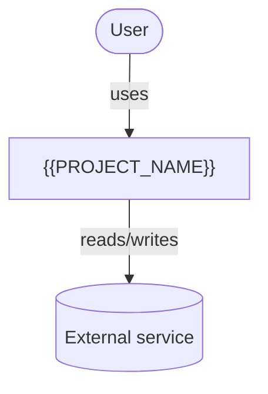
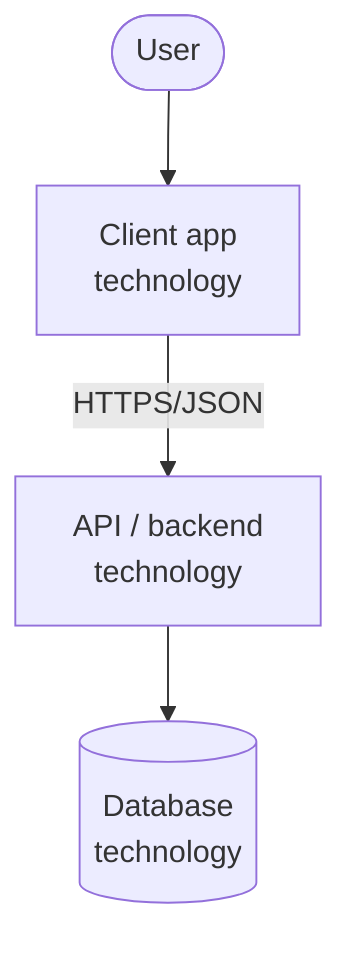
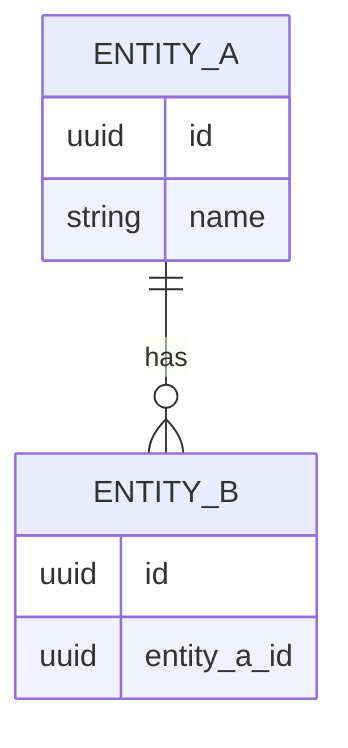
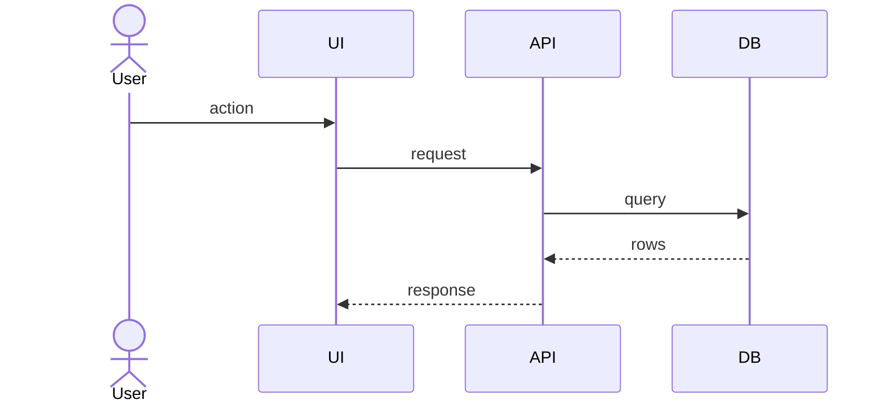

# Architecture — {{PROJECT_NAME}}

> **Last updated:** {{DATE}}
> Phase 3 deliverable; keep current — structural changes update this doc in the same PR.

## 1. Overview
<!-- 3–5 sentences: what the system is, main parts, where it runs. -->

**Stack:** {{STACK}} — see ADRs for the reasoning.

## 2. Non-functional requirements

| Concern | Requirement |
|---|---|
| Platforms | … |
| Offline | … |
| Auth & privacy | … |
| Performance | … |
| Data volume | … |
| Availability / backups | … |
| Cost | … |

## 3. System context (C4 level 1)



## 4. Containers (C4 level 2)



| Container | Technology | Responsibility | Deployed on |
|---|---|---|---|
| … | … | … | … |

## 5. Domain model



## 6. Code structure

```text
src/
  domain/          # entities, business rules — depends on nothing
  application/     # use cases — depends on domain
  infrastructure/  # DB, APIs, files — implements application ports
  ui/              # screens/components — calls application
tests/
```

**Dependency rule:** ui → application → domain; infrastructure → application/domain. Never domain → anything.

## 7. Key flows
<!-- Sequence diagrams for 1–2 non-trivial flows (sync, auth, notifications…). -->


## 8. Cross-cutting concerns

- **Configuration & secrets:** env vars, `.env` not committed (`.env.example` is).
- **Error handling & logging:** …
- **Testing:** unit (domain/application), integration (infrastructure), 1–3 smoke tests (ui). Coverage ≥ 70%.
- **Deployment:** …
- **Backups / data export:** …

## 9. Decisions

See [`adr/`](adr/). Index:

| ADR | Title | Status |
|---|---|---|
| [0001](adr/0001-record-architecture-decisions.md) | Record architecture decisions | Accepted |
