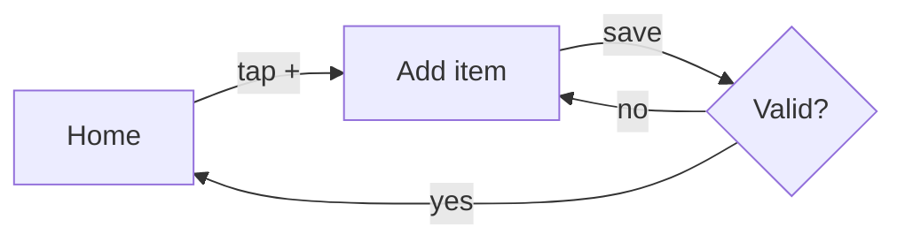

# Design — {{PROJECT_NAME}}

> **Penpot project:** {{PENPOT_URL}}
> Phase 2 deliverable. Exit gate: every Must feature has a flow + wireframe; empty/error states designed; key screens in hi-fi.

## Penpot pages

| Page | Link | Status |
|---|---|---|
| 00 Cover | … | |
| 01 User flows | … | |
| 02 Wireframes (low-fi) | … | |
| 03 Key screens (hi-fi) | … | |
| 04 Style guide | … | |

## User flows
<!-- One per scenario from the brief. Mermaid is fine for simple flows; link Penpot for the rest. -->
### Scenario 1 — <name>

## Screen inventory

| Screen | Purpose | Features (Must) | States designed | Wireframe | Hi-fi |
|---|---|---|---|---|---|
| Home | … | … | default · empty · loading · error | link | link / — |

**Coverage check:** every Must feature from the brief appears in at least one row. ☐

## Style guide (summary)

| Token | Value |
|---|---|
| Primary | `#……` |
| Accent | `#……` |
| Neutrals | `#……` → `#……` |
| Font | … (sizes: 12 / 14 / 16 / 20 / 28) |
| Spacing scale | 4 · 8 · 16 · 24 · 32 |
| Corner radius | … |

## Accessibility

- [ ] Text contrast ≥ 4.5:1
- [ ] Touch targets ≥ 44×44 pt
- [ ] Meaning not conveyed by color alone
- [ ] Every input has a visible label

## Design decisions

| Date | Decision | Why |
|---|---|---|
| {{DATE}} | … | … |
